---

# Parte I — Análisis del Problema y Diseño de Datos

## 1. Análisis del dominio

El dominio modela la operatoria comercial de una cadena hotelera basada en la gestión exclusiva de reservas de habitaciones para huéspedes, así como el registro de sus puntos de interés y canales de comunicación. Las reglas de negocio críticas determinan que una habitación física no admite reservas simultáneas con solapamiento temporal y que el valor de la tarifa se fija estrictamente al momento de la confirmación. A partir de estos requerimientos, se formalizan textualmente las siguientes entidades y estructuras del sistema:

| Tabla / Entidad | Rol en el Modelo | Atributos Identificados |
| :--- | :--- | :--- |
| `hotel` | Entidad Base | `id`, `nombre`, `valoracion`, `direccion`, `ciudad`, `provincia`, `pais` |
| `punto_interes` | Entidad Base | `id`, `nombre`, `categoria` |
| `hotel_punto_interes` | Asociativa (TEA) | `id_hotel`, `id_punto_interes` |
| `habitacion` | Entidad Base | `id`, `hotel_id`, `numero`, `piso`, `capacidad`, `precio_base` |
| `comodidad` | Entidad Base | `id`, `nombre`, `descripcion` |
| `habitacion_comodidad` | Asociativa (TEA) | `id_habitacion`, `id_comodidad` |
| `huesped` | Entidad Base | `id`, `dni`, `nombre`, `apellido`, `direccion`, `nacionalidad` |
| `contacto` | Entidad Base | `id`, `tipo`, `valor` |
| `hotel_contacto` | Asociativa (TEA) | `id_hotel`, `id_contacto`, `descripcion` |
| `huesped_contacto` | Asociativa (TEA) | `id_huesped`, `id_contacto`, `descripcion` |
| `reserva` | Transaccional | `id`, `id_huesped`, `id_habitacion`, `fecha_inicio`, `fecha_salida`, `estado`, `tarifa` |

<div style="page-break-after: always;"></div>

## 2. Modelo relacional

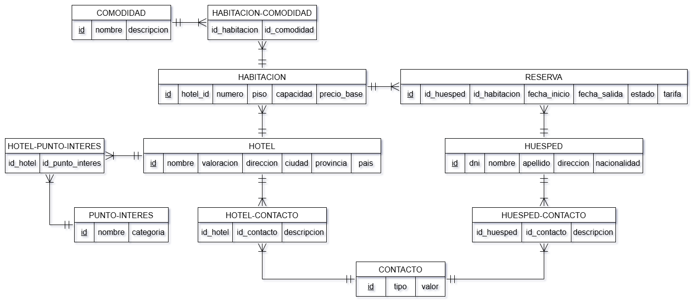

## 3. Normalización

El esquema diseñado satisface rigurosamente Tercera Forma Normal (3FN): cumple 1FN por atomicidad de dominios y resolución de relaciones multivaluadas mediante tablas de entidad asociativa (`hotel_contacto`, `huesped_contacto`, `hotel_punto_interes` y `habitacion_comodidad`); cumple 2FN al presentar dependencia funcional completa respecto de la totalidad de las claves primarias; y cumple 3FN al no existir dependencias transitivas entre atributos no primos (la información descriptiva de hoteles, habitaciones y huéspedes reside exclusivamente en sus tablas maestras), eliminando anomalías de inserción, modificación y borrado.

## 4. Integridad y reglas de negocio

A nivel de base de datos se implementan claves primarias autoincrementales, claves foráneas con política `ON DELETE RESTRICT`, cláusulas `NOT NULL`, restricciones `CHECK` para coherencia cronológica (`fecha_salida > fecha_inicio`), categorías y estados permitidos, junto a una restricción de exclusión física en PostgreSQL (`EXCLUDE USING gist`) que veta a nivel de almacenamiento el solapamiento de fechas para una misma habitación; delegando a la capa de aplicación el cálculo dinámico de promociones comerciales, validaciones sintácticas complejas y el envío asíncrono de notificaciones.

## 5. Normalización versus desnormalización

El modelo base se encuentra normalizado en 3FN, relacionando `reserva` con `hotel` a través de la tabla `habitacion`. Para optimizar consultas de reportes gerenciales sobre la tabla transaccional `reserva`, un escenario de desnormalización controlada consiste en replicar el atributo `hotel_id` directamente en la entidad `reserva`, eliminando el costo de I/O de un join recurrente contra la tabla `habitacion` al agregar métricas por establecimiento; mitigando el riesgo de discrepancias mediante un trigger automático en base de datos (`BEFORE INSERT OR UPDATE`) que garantiza la integridad referencial sin intervención del usuario.

<div style="page-break-after: always;"></div>   

# Parte II — Diseño Físico y Almacenamiento

## 6. Implementación física

La base de datos se implementa físicamente sobre PostgreSQL 16 desplegado en un contenedor Docker con almacenamiento persistente y red aislada `redPostgres`. El script DDL completo crea la extensión `btree_gist`, las seis entidades principales, las cuatro tablas de entidad asociativa (TEAs) y la tabla transaccional `reserva` con sus respectivas restricciones de integridad y exclusión temporal:

```sql
-- Extensión para operadores de rango e indexación GiST sobre enteros
CREATE EXTENSION IF NOT EXISTS btree_gist;

CREATE TABLE hotel (
    id INT GENERATED ALWAYS AS IDENTITY PRIMARY KEY,
    nombre VARCHAR(100) NOT NULL,
    valoracion SMALLINT NOT NULL CHECK (valoracion BETWEEN 1 AND 5),
    direccion VARCHAR(150) NOT NULL,
    ciudad VARCHAR(80) NOT NULL,
    provincia VARCHAR(80) NOT NULL,
    pais VARCHAR(80) NOT NULL
);

CREATE TABLE punto_interes (
    id INT GENERATED ALWAYS AS IDENTITY PRIMARY KEY,
    nombre VARCHAR(120) NOT NULL,
    categoria VARCHAR(50) NOT NULL
);

CREATE TABLE comodidad (
    id INT GENERATED ALWAYS AS IDENTITY PRIMARY KEY,
    nombre VARCHAR(60) NOT NULL UNIQUE,
    descripcion VARCHAR(200)
);

CREATE TABLE habitacion (
    id INT GENERATED ALWAYS AS IDENTITY PRIMARY KEY,
    hotel_id INT NOT NULL REFERENCES hotel(id) ON DELETE RESTRICT,
    numero VARCHAR(10) NOT NULL,
    piso SMALLINT NOT NULL,
    capacidad SMALLINT NOT NULL CHECK (capacidad >= 1),
    precio_base NUMERIC(10,2) NOT NULL CHECK (precio_base > 0),
    CONSTRAINT uq_habitacion_hotel_numero UNIQUE (hotel_id, numero)
);

CREATE TABLE huesped (
    id BIGINT GENERATED ALWAYS AS IDENTITY PRIMARY KEY,
    dni VARCHAR(20) NOT NULL UNIQUE,
    nombre VARCHAR(80) NOT NULL,
    apellido VARCHAR(80) NOT NULL,
    direccion VARCHAR(150) NOT NULL,
    nacionalidad VARCHAR(50) NOT NULL
);

CREATE TABLE contacto (
    id BIGINT GENERATED ALWAYS AS IDENTITY PRIMARY KEY,
    tipo VARCHAR(20) NOT NULL CHECK (tipo IN ('TELEFONO', 'EMAIL')),
    valor VARCHAR(120) NOT NULL
);

CREATE TABLE hotel_punto_interes (
    id_hotel INT NOT NULL REFERENCES hotel(id) ON DELETE RESTRICT,
    id_punto_interes INT NOT NULL REFERENCES punto_interes(id) ON DELETE RESTRICT,
    PRIMARY KEY (id_hotel, id_punto_interes)
);

CREATE TABLE habitacion_comodidad (
    id_habitacion INT NOT NULL REFERENCES habitacion(id) ON DELETE RESTRICT,
    id_comodidad INT NOT NULL REFERENCES comodidad(id) ON DELETE RESTRICT,
    PRIMARY KEY (id_habitacion, id_comodidad)
);

CREATE TABLE hotel_contacto (
    id_hotel INT NOT NULL REFERENCES hotel(id) ON DELETE RESTRICT,
    id_contacto BIGINT NOT NULL REFERENCES contacto(id) ON DELETE RESTRICT,
    descripcion VARCHAR(100),
    PRIMARY KEY (id_hotel, id_contacto)
);

CREATE TABLE huesped_contacto (
    id_huesped BIGINT NOT NULL REFERENCES huesped(id) ON DELETE RESTRICT,
    id_contacto BIGINT NOT NULL REFERENCES contacto(id) ON DELETE RESTRICT,
    descripcion VARCHAR(100),
    PRIMARY KEY (id_huesped, id_contacto)
);

CREATE TABLE reserva (
    id BIGINT GENERATED ALWAYS AS IDENTITY PRIMARY KEY,
    id_huesped BIGINT NOT NULL REFERENCES huesped(id) ON DELETE RESTRICT,
    id_habitacion INT NOT NULL REFERENCES habitacion(id) ON DELETE RESTRICT,
    fecha_inicio DATE NOT NULL,
    fecha_salida DATE NOT NULL,
    estado VARCHAR(20) NOT NULL CHECK (estado IN ('PENDIENTE', 'CONFIRMADA', 'CANCELADA', 'FINALIZADA')),
    tarifa NUMERIC(10,2) CHECK (tarifa IS NULL OR tarifa > 0),
    CONSTRAINT chk_reserva_fechas CHECK (fecha_salida > fecha_inicio),
    CONSTRAINT chk_reserva_tarifa_confirmada CHECK (
        (estado = 'CONFIRMADA' AND tarifa IS NOT NULL) OR (estado != 'CONFIRMADA')
    ),
    CONSTRAINT no_superposicion_fechas_habitacion EXCLUDE USING gist (
        id_habitacion WITH =,
        daterange(fecha_inicio, fecha_salida, '[]') WITH &&
    ) WHERE (estado != 'CANCELADA')
);
```

## 7. Selección de tipos de datos

La asignación de tipos físicos prioriza la economía de almacenamiento y la precisión contable: se adoptó `BIGINT` (8 bytes) para las claves primarias y foráneas de tablas con crecimiento masivo (`reserva`, `huesped`, `contacto`) garantizando que no se desborde el límite de 2.147 millones de registros de un entero convencional, mientras que se utilizó `INT` (4 bytes) para tablas de catálogo y dimensión acotada (`hotel`, `habitacion`, `punto_interes`, `comodidad`); se seleccionó `SMALLINT` (2 bytes) para `valoracion`, `piso` y `capacidad`, reduciendo a la mitad el consumo de memoria respecto a un entero estándar; para texto se optó por `VARCHAR(n)` estableciendo límites semánticos sin desperdiciar espacio, ya que en PostgreSQL no existe penalización de rendimiento frente a `TEXT`; para las fechas se empleó `DATE` (4 bytes) al no requerirse componente horario, lo cual ahorra 4 bytes por tupla respecto a `TIMESTAMP` (8 bytes), reduciendo significativamente el consumo de almacenamiento en disco e I/O; y para los valores monetarios (`tarifa` y `precio_base`) se definió `NUMERIC(10,2)`, garantizando aritmética de punto fijo con exactitud decimal absoluta y eliminando los errores de redondeo inherentes a `FLOAT` o `DOUBLE`.

## 8. Claves y restricciones físicas

Las restricciones se implementan para asegurar la integridad referencial y de dominio sin fisuras a nivel de almacenamiento: las claves primarias utilizan `GENERATED ALWAYS AS IDENTITY`, generando automáticamente índices B-Tree únicos para búsquedas rápidas; las claves foráneas aplican la cláusula `ON DELETE RESTRICT` para blindar el historial transaccional contra eliminaciones accidentales en cascada; se fija la restricción de unicidad compuesta `UNIQUE(hotel_id, numero)` en `habitacion` para evitar duplicación de puertas; y se establecen restricciones `CHECK` para validar rangos numéricos (`valoracion BETWEEN 1 AND 5`, `capacidad >= 1`), coherencia cronológica (`fecha_salida > fecha_inicio`), estados discretos válidos y obligatoriedad de `tarifa` exclusivamente al confirmarse.

Para garantizar físicamente la no superposición de períodos sobre una misma habitación aplicando límites cerrados/inclusivos `[]` (un nuevo huésped solo puede ingresar con al menos un día de diferencia respecto al egreso anterior), se implementa mediante la extensión `btree_gist` la siguiente restricción de exclusión:

```sql
ALTER TABLE reserva
ADD CONSTRAINT no_superposicion_fechas_habitacion
EXCLUDE USING gist (
    id_habitacion WITH =,
    daterange(fecha_inicio, fecha_salida, '[]') WITH &&
) WHERE (estado != 'CANCELADA');
```

## 9. Motor y estructuras de almacenamiento

Al utilizar PostgreSQL, el motor organiza internamente la información en bloques de memoria y páginas de disco administradas a través de su búfer compartido (*shared_buffers*). Para respaldar la integridad transaccional y asegurar las propiedades ACID frente a posibles caídas del sistema o cortes de energía, el motor utiliza el mecanismo de Write-Ahead Logging (WAL), registrando de forma secuencial cada operación en el log antes de escribir los cambios en las tablas principales, lo que permite recuperar la base de datos de manera consistente y atender transacciones concurrentes de lectura y escritura de forma eficiente.

## 10. Estrategias de almacenamiento

El diseño físico determina directamente el rendimiento de entrada/salida (I/O): al ser los bloques físicos de 8 KB, compactar el ancho en bytes de cada fila maximiza la densidad de tuplas por página, disminuyendo drásticamente la cantidad de lecturas a disco requeridas e incrementando la tasa de aciertos en caché (*cache hit ratio*). En tablas transaccionales de alto crecimiento como `reserva`, cada índice B-Tree adicional ocupa espacio relevante en disco y memoria e impone una sobrecarga durante las operaciones de inserción y modificación, además de acelerar la degradación por tuplas muertas propia del motor, lo que exige políticas periódicas de mantenimiento con `VACUUM`. El entorno formal de experimentación para este proyecto se encuentra desplegado sobre PostgreSQL 16.x en contenedor Docker con memoria compartida ampliada (`shm_size: 256mb`) y red bridge privada (`redPostgres`), operando sobre almacenamiento de estado sólido SSD NVMe bajo sistema operativo Windows 11 y subsistema WSL2.

# Parte III — Índices y Estructuras de Acceso

## 11. Estrategia general de índices

La estrategia de indexación busca acelerar las consultas más frecuentes y los cruces por clave foránea, minimizando el acceso a disco sin sobrecargar las operaciones de escritura.

| Tabla | Índice | Columnas | Propósito |
| :--- | :--- | :--- | :--- |
| `habitacion` | `idx_habitacion_hotel_id` | `hotel_id` | Acelerar `JOIN` con `hotel` |
| `reserva` | `idx_reserva_id_huesped` | `id_huesped` | Historial de reservas por huésped |
| `reserva` | `idx_reserva_id_habitacion` | `id_habitacion` | Búsqueda de reservas por habitación |
| `reserva` | `idx_reserva_compuesto_estado_fecha` | `(estado, fecha_inicio)` | Filtros combinados por estado y fecha |
| `reserva` | `idx_reserva_cobertura_huesped_estado` | `(id_huesped, estado)` INCLUDE `(tarifa)` | *Index Only Scan* en consultas de facturación |
| `reserva` | `idx_reserva_anio_inicio` | `(EXTRACT(YEAR FROM fecha_inicio))` | Consultas históricas por año |
| `reserva` | `no_superposicion_fechas_habitacion` | `id_habitacion`, `daterange(...)` | Exclusión física de solapamientos (GiST) |
| `huesped` | `idx_huesped_apellido_lower` | `(LOWER(apellido))` | Búsquedas insensibles a mayúsculas |
| TEAs | `idx_*_fk` | Claves foráneas asociativas | Cruces directos e inversos |

## 12. Arboles B-Tree y B+Tree

El B+Tree es la estructura por defecto en PostgreSQL: almacena todos los datos y punteros a tuplas (*Tuple IDs*) en las hojas enlazadas bidireccionalmente, reservando los nodos internos exclusivamente para enrutamiento. Esto maximiza el factor de ramificación y mantiene una altura mínima ($h \le 3$ o $4$). Frente al costo lineal $O(N)$ de una búsqueda secuencial (`Seq Scan`), el índice reduce el acceso a costo logarítmico $O(\log_B N)$. Al residir los nodos superiores en memoria (`shared_buffers`), recuperar un registro requiere típicamente solo 1 o 2 lecturas físicas de páginas de 8 KB.

## 13. Otros tipos de índices

* **Hash:** Búsqueda en $O(1)$ exclusivamente para comparaciones de igualdad estricta (`=`). No soporta rangos ni ordenamientos.
* **GiST:** Árbol jerárquico para datos complejos. Utilizado en este proyecto para evaluar superposición temporal (`&&`) y aplicar restricciones de exclusión.
* **GIN:** Índice invertido diseñado para tipos con múltiples elementos por tupla (`JSONB`, texto completo o arreglos). Eficiente para operadores de contención (`@>`).
* **BRIN:** Almacena solo los valores mínimo y máximo por rango de páginas (por defecto 128 bloques). Ocupa espacio despreciable (< 1% de un B-Tree) y es óptimo para datos ordenados físicamente por fecha o secuencia.

## 14. Índices compuestos y regla del prefijo izquierdo

Un índice compuesto ordena las filas jerárquicamente: primero por la columna inicial y luego por las sucesivas. Según la regla del prefijo izquierdo (*leftmost prefix rule*), el optimizador solo utiliza el índice si la consulta filtra por la primera columna definida. Si se omite dicha columna líder, el motor descarta el índice y recurre a `Seq Scan`.

```sql
-- Índice compuesto sobre estado y fecha
CREATE INDEX idx_reserva_compuesto_estado_fecha ON reserva(estado, fecha_inicio);

-- Usa índice (incluye prefijo izquierdo 'estado'):
SELECT * FROM reserva WHERE estado = 'CONFIRMADA' AND fecha_inicio >= '2026-11-01';

-- No usa índice compuesto (omite prefijo izquierdo; recurre a Seq Scan):
SELECT * FROM reserva WHERE fecha_inicio >= '2026-11-01';
```

## 15. Índices de cobertura

Un índice de cobertura contiene todas las columnas requeridas por una consulta (filtros y proyecciones), permitiendo resolverla mediante *Index Only Scan* sin acceder a las páginas de datos de la tabla (*heap*). En PostgreSQL se define mediante la cláusula `INCLUDE`, agregando columnas adicionales como carga útil (*payload*) en las hojas sin alterar la clave de ordenamiento.

```sql
-- Índice de cobertura: incluye 'tarifa' en las hojas
CREATE INDEX idx_reserva_cobertura_huesped_estado 
ON reserva (id_huesped, estado) INCLUDE (tarifa);

-- Resuelta enteramente desde el índice (Index Only Scan):
SELECT id_huesped, estado, tarifa FROM reserva WHERE id_huesped = 101 AND estado = 'CONFIRMADA';
```

## 16. Índices funcionales o basados en expresiones

PostgreSQL soporta índices funcionales que almacenan el resultado precomputado de una expresión, evitando la pérdida de SARGabilidad al filtrar por campos transformados.

```sql
-- Índice funcional para búsquedas insensibles a mayúsculas
CREATE INDEX idx_huesped_apellido_lower ON huesped (LOWER(apellido));

-- Aprovecha el índice funcional en lugar de hacer Seq Scan:
SELECT id, dni, nombre, apellido FROM huesped WHERE LOWER(apellido) = 'gonzalez';
```

Su ventaja es acelerar lecturas que aplican funciones deterministas; su costo es el procesamiento extra durante `INSERT` y `UPDATE` para evaluar y almacenar la expresión calculada.

## 17. Cardinalidad y selectividad

La cardinalidad es la cantidad de valores únicos de una columna (alta en `dni`, muy baja en `estado`), mientras que la selectividad es el porcentaje de filas devueltas respecto al total ($\text{filas devueltas} / \text{total}$). Los índices B-Tree son rentables con alta selectividad (filtros que recuperan menos del 10%-15% de la tabla). Cuando la selectividad es baja y devuelve una porción representativa de la relación, el optimizador descarta el índice y ejecuta un `Seq Scan` para evitar el costo de accesos aleatorios por punteros TID.

## 18. ¿Por qué no indexar todos los campos?

Indexar indiscriminadamente penaliza severamente el sistema:
1. **Escritura (INSERT/UPDATE/DELETE):** Cada fila insertada exige actualizar todos los árboles de la tabla, provocando divisiones de página (*page splits*) y abundante tráfico WAL. En actualizaciones, rompe la optimización HOT (*Heap-Only Tuples*).
2. **Almacenamiento y memoria:** Los índices pueden superar en tamaño a los datos de la propia tabla, expulsando páginas útiles del búfer de memoria (`shared_buffers`) y aumentando el volumen de tuplas muertas (*bloat*) que debe limpiar el proceso de `VACUUM`.

# Parte IV — Datos, Carga masiva y Metodología experimental

## 19. Generación de datos de prueba

La generación de datos de prueba se diseñó de forma reproducible utilizando `generate_series()` en PostgreSQL, respetando las restricciones de clave foránea y generando valores de dominio realistas.

```sql
INSERT INTO hotel (nombre, valoracion, direccion, ciudad, provincia, pais)
SELECT 
    d.prefijos[1 + (i % 15)] || ' ' || d.sufijos[1 + ((i * 7) % 20)],
    (CASE WHEN i % 10 IN (0, 1) THEN 3 WHEN i % 10 BETWEEN 2 AND 7 THEN 4 ELSE 5 END)::SMALLINT,
    d.calles[1 + (i % 15)] || ' ' || (120 + ((i * 47) % 3800)),
    d.ciudades[1 + (i % 15)],
    d.provincias[1 + (i % 15)],
    'Argentina'
FROM generate_series(1, 200) AS i, data_hoteles d;

INSERT INTO habitacion (hotel_id, numero, piso, capacidad, precio_base)
SELECT 
    (1 + ((i - 1) / 50))::INT,
    (((1 + (((i - 1) % 50) / 10)) * 100) + (1 + ((i - 1) % 10)))::VARCHAR,
    (1 + (((i - 1) % 50) / 10))::SMALLINT,
    (ARRAY[1, 2, 2, 2, 3, 4])[1 + (i % 6)]::SMALLINT,
    ROUND((50.00 + ((ARRAY[1, 2, 2, 2, 3, 4])[1 + (i % 6)] * 22.50) + ((i % 10) * 6.50))::NUMERIC, 2)
FROM generate_series(1, 10000) AS i;

INSERT INTO huesped (dni, nombre, apellido, direccion, nacionalidad)
SELECT 
    LPAD((20000000 + ((i::BIGINT * 15485863 + 4956133) % 27999999))::TEXT, 8, '0'),
    d.nombres[1 + (i % 30)],
    d.apellidos[1 + ((i * 3) % 30)],
    d.calles[1 + (i % 15)] || ' ' || (100 + ((i * 37) % 4500)),
    d.nacionalidades[1 + (i % 10)]
FROM generate_series(1, 50000) AS i, data_huespedes d;

INSERT INTO contacto (tipo, valor)
SELECT 
    CASE WHEN i % 2 = 0 THEN 'EMAIL' ELSE 'TELEFONO' END,
    CASE 
        WHEN i % 2 = 0 THEN 
            d.nombres[1 + (i % 15)] || '.' || d.apellidos[1 + ((i * 3) % 15)] || (10 + (i % 89))::TEXT || '@' || d.dominios[1 + (i % 5)]
        ELSE 
            d.prefijos_tel[1 + (i % 6)] || ' ' || (420 + (i % 450))::TEXT || '-' || LPAD(((i * 73) % 10000)::TEXT, 4, '0')
    END
FROM generate_series(1, 15000) AS i, data_contactos d;
```

## 20. Carga masiva

La carga masiva de los 6.000.000 de registros en `reserva` se completó en **5 minutos 51 segundos**. Para evitar cuellos de botella de I/O y saturación de WAL, se configuró `synchronous_commit = off`, se deshabilitaron temporalmente los índices y la restricción GiST durante la inserción secuencial, y se reconstruyeron posteriormente en bloque con `VACUUM ANALYZE`. La tabla alcanzó un peso en disco de 438 MB y sus índices asociados 1 GB.

```sql
INSERT INTO reserva (id_huesped, id_habitacion, fecha_inicio, fecha_salida, estado, tarifa)
SELECT 
    (1 + ((i * 37) % 50000))::BIGINT,
    (1 + ((i - 1) % 10000))::INT,
    (DATE '2012-01-01' + (((i - 1) / 10000) * 8) * INTERVAL '1 day')::DATE,
    (DATE '2012-01-01' + (((i - 1) / 10000) * 8 + (2 + (i % 5))) * INTERVAL '1 day')::DATE,
    (CASE 
        WHEN i % 20 = 0 THEN 'CANCELADA'
        WHEN i % 20 = 1 THEN 'PENDIENTE'
        WHEN i % 20 BETWEEN 2 AND 14 THEN 'FINALIZADA'
        ELSE 'CONFIRMADA'
    END)::VARCHAR,
    ROUND((75.00 + ((i % 250) * 2.50))::NUMERIC, 2)
FROM generate_series(1, 6000000) AS i;
```

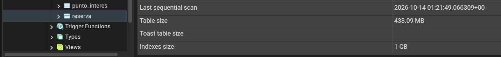

## 21. Distribución de los datos

La distribución de los datos se constató empíricamente sobre las 6.000.000 de tuplas: `huesped` y `habitacion` presentan una distribución uniforme de alta cardinalidad, mientras que `estado` en `reserva` exhibe una distribución sesgada con métricas exactas: 'FINALIZADA' con 3.900.000 registros (65,00%), 'CONFIRMADA' con 1.500.000 (25,00%), 'CANCELADA' con 300.000 (5,00%) y 'PENDIENTE' con 300.000 (5,00%). Estas frecuencias fueron muestreadas por `VACUUM ANALYZE` y consolidadas en `pg_stats` en la lista MCV (*Most Common Values*). En consecuencia, para predicados de baja selectividad sobre valores predominantes (`WHERE estado = 'FINALIZADA'`), el planificador descarta los índices y ejecuta `Seq Scan` al estimar un retorno del 65% del volumen; por el contrario, ante valores de alta selectividad (`WHERE estado = 'CANCELADA'`), el motor selecciona automáticamente accesos indexados B-Tree (`Bitmap Index Scan`), comprobando el comportamiento adaptativo del optimizador.

## 22. Metodología de benchmarking

Las mediciones se realizan bajo condiciones controladas de aislamiento en una sesión única sobre el contenedor Docker, registrando planes y tiempos de ejecución mediante `EXPLAIN (ANALYZE, BUFFERS)`.

| Parámetro | Especificación del Entorno |
| :--- | :--- |
| **Motor BD** | PostgreSQL 16.x sobre Linux en contenedor Docker |
| **Almacenamiento** | SSD NVMe (volumen persistente `volPostgres`) |
| **Sistema Operativo** | Windows 11 con subsistema WSL2 |
| **Memoria del motor** | `shared_buffers = 256MB`, `work_mem = 4MB` |
| **Volumen de datos** | 6.000.000 tuplas en `reserva` (438 MB tabla, 1 GB índices) |
| **Conexiones** | Sesión única interactiva administrada desde pgAdmin 4 |

## 23. Cold Cache y Warm Cache

El comportamiento del motor difiere drásticamente según el estado del búfer compartido: en **Cold Cache** (caché fría), las páginas no residen en RAM y deben solicitarse físicamente al SSD (`Buffers: read`), registrándose en las pruebas 1,150 ms con lecturas a disco; en **Warm Cache** (caché caliente), las páginas ya residen en `shared_buffers` y la consulta se resuelve por memoria (`Buffers: hit=7`, `read=0`) descendiendo a 0,041 ms (una aceleración empírica de 22x). Para evitar conclusiones erróneas en benchmarking, deben descartarse las primeras ejecuciones al evaluar algoritmos en régimen estacionario, o bien reiniciar el servicio para mediciones estrictas de peor caso de I/O físico.

```sql
EXPLAIN (ANALYZE, BUFFERS)
SELECT * FROM reserva WHERE id = 4781900;
```

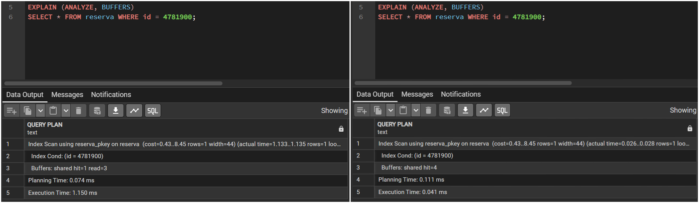

# Parte V — SQL y Consultas del Sistema

## 24. Consultas SQL de dificultad progresiva

Se diseñaron consultas representativas organizadas en niveles crecientes de complejidad sintáctica y relacional sobre el modelo hotelero.

```sql
-- 1. Básica: Agrupación y métricas de tarifa por estado
SELECT estado, COUNT(*) AS total_reservas, ROUND(AVG(tarifa), 2) AS tarifa_promedio
FROM reserva
GROUP BY estado;

-- 2. Intermedia: Cruce con JOINs y clasificación condicional con CASE WHEN
SELECT h.nombre AS hotel, hab.numero,
       CASE WHEN hab.capacidad = 1 THEN 'Individual'
            WHEN hab.capacidad = 2 THEN 'Doble'
            ELSE 'Suite' END AS categoria,
       hab.precio_base
FROM habitacion hab
INNER JOIN hotel h ON h.id = hab.hotel_id
LIMIT 10;

-- 3. Avanzada: Subconsulta correlacionada con operador EXISTS
SELECT cli.id, cli.dni, cli.apellido, cli.nombre
FROM huesped cli
WHERE EXISTS (
    SELECT 1 FROM reserva r 
    WHERE r.id_huesped = cli.id AND r.estado = 'CONFIRMADA'
)
LIMIT 10;
```

## 25. Consultas complejas

Se desarrollaron 15 consultas complejas orientadas a casos reales de reportería y gestión hotelera (disponibilidad, recaudación histórica, ocupación y fidelidad), de las cuales 6 involucran 4 o más tablas relacionales. El repertorio completo se encuentra implementado en el script `parte5.sql`.

| ID | Caso de Uso del Sistema | Tablas Involucradas |
| :---: | :--- | :--- |
| C1 | Disponibilidad por período sin solapamiento | `hotel`, `habitacion`, `reserva` |
| C2 | Ranking Top 10 hoteles por recaudación histórica | `hotel`, `habitacion`, `reserva` |
| C3* | Huéspedes con reservas, habitación y comodidades | `huesped`, `reserva`, `habitacion`, `hotel`, `habitacion_comodidad`, `comodidad` (6) |
| C4* | Hoteles cercanos a atractivos de 'Naturaleza' | `hotel`, `hotel_punto_interes`, `punto_interes`, `habitacion`, `reserva` (5) |
| C5* | Auditoría de reserva con contactos de huésped y hotel | `reserva`, `huesped`, `huesped_contacto`, `contacto`, `habitacion`, `hotel`, `hotel_contacto` (7) |
| C6* | Demanda y facturación por nacionalidad y categoría | `huesped`, `reserva`, `habitacion`, `hotel` (4) |
| C7* | Puntos de interés más visitados indirectamente | `punto_interes`, `hotel_punto_interes`, `hotel`, `habitacion`, `reserva` (5) |
| C8 | Demanda histórica anual y recaudación | `reserva` |
| C9 | Duración promedio de estadía por capacidad | `habitacion`, `reserva` |
| C10 | Fidelidad: Huéspedes con más de 120 reservas | `huesped`, `reserva` |
| C11 | Tasa porcentual de cancelación por hotel | `hotel`, `habitacion`, `reserva` |
| C12 | Facturación acumulada por destino turístico | `hotel`, `habitacion`, `reserva` |
| C13 | Habitaciones sin reservas activas por rango | `hotel`, `habitacion`, `reserva` |
| C14* | Demanda de comodidades en reservas finalizadas | `comodidad`, `habitacion_comodidad`, `habitacion`, `reserva` (4) |
| C15 | Ocupación mensual y tarifa por piso de edificio | `habitacion`, `reserva` |

*\* Consultas con cuatro o más tablas.*

```sql
-- Consulta representativa C6 (4 tablas): Facturación por nacionalidad y categoría
SELECT cli.nacionalidad, h.valoracion AS estrellas, COUNT(r.id) AS reservas, SUM(r.tarifa) AS total_ingresos
FROM huesped cli
INNER JOIN reserva r ON r.id_huesped = cli.id
INNER JOIN habitacion hab ON hab.id = r.id_habitacion
INNER JOIN hotel h ON h.id = hab.hotel_id
WHERE r.estado IN ('CONFIRMADA', 'FINALIZADA')
GROUP BY cli.nacionalidad, h.valoracion
ORDER BY cli.nacionalidad, h.valoracion DESC
LIMIT 10;
```

## 26. Consultas sobre disponibilidad

Para determinar si una habitación está disponible sin violar las reglas de negocio, se comprueba la no existencia (`NOT EXISTS`) de reservas activas (`estado != 'CANCELADA'`) que solapen el rango solicitado. En PostgreSQL esto se resuelve de forma óptima mediante el operador de superposición `&&` sobre tipos `daterange` respaldado por el índice GiST.

```sql
-- Verificación de disponibilidad para una habitación en un intervalo solicitado
SELECT hab.id AS habitacion_id, hab.numero, h.nombre AS hotel,
       CASE WHEN EXISTS (
           SELECT 1 FROM reserva r 
           WHERE r.id_habitacion = hab.id 
             AND r.estado != 'CANCELADA'
             AND daterange(r.fecha_inicio, r.fecha_salida, '[]') && daterange('2026-04-10'::DATE, '2026-04-15'::DATE, '[]')
       ) THEN 'NO DISPONIBLE' ELSE 'DISPONIBLE' END AS estado
FROM habitacion hab
INNER JOIN hotel h ON h.id = hab.hotel_id
WHERE hab.id = 105;
```

## 27. Consultas históricas y temporales

La formulación de filtros temporales impacta directamente en la capacidad del optimizador para usar índices. La aplicación de funciones como `EXTRACT` sobre la columna dentro del `WHERE` anula la SARGabilidad en un índice B-Tree convencional, obligando a un recorrido secuencial; en contraste, expresar el filtro como un rango directo de fechas permite un escaneo indexado directo.

```sql
-- Forma A (No SARGable: evalúa función por tupla, inhabilita B-Tree estándar):
SELECT COUNT(*), SUM(tarifa) FROM reserva WHERE EXTRACT(YEAR FROM fecha_inicio) = 2024;

-- Forma B (SARGable: rango directo sobre la columna, permite Index Scan):
SELECT COUNT(*), SUM(tarifa) FROM reserva 
WHERE fecha_inicio >= '2024-01-01' AND fecha_inicio < '2025-01-01';
```

## 28. Transporte de datos

El volumen de datos transferidos entre el motor y el cliente incide en el ancho de banda y la memoria de red: utilizar `SELECT *` traslada innecesariamente columnas no requeridas e imposibilita lecturas de solo índice (*Index Only Scan*). Asimismo, la paginación tradicional con `OFFSET` obliga al motor a leer y descartar todas las filas previas antes de retornar la página solicitada ($O(N)$), mientras que la paginación por clave (*Keyset Pagination*) accede de forma indexada directa en $O(1)$ sin sobrecargar I/O.

```sql
-- Paginación clásica por OFFSET (ineficiente al leer y descartar N tuplas):
SELECT id, id_huesped, tarifa FROM reserva ORDER BY id LIMIT 20 OFFSET 500000;

-- Paginación por Keyset / Cursor (acceso indexado directo en O(1)):
SELECT id, id_huesped, tarifa FROM reserva WHERE id > 500000 ORDER BY id LIMIT 20;
```

# PARTE VI — Optimizador, SARGabilidad y Planes de Ejecución

## 29. EXPLAIN y EXPLAIN ANALYZE

La instrucción `EXPLAIN` expone el plan de ejecución estimado por el optimizador de costos (costos y cardinalidad esperada), mientras que `EXPLAIN ANALYZE` ejecuta materialmente la consulta en el motor y registra métricas reales de tiempo, filas procesadas y consumo de buffers de memoria y disco.

```sql
EXPLAIN (ANALYZE, BUFFERS)
SELECT r.id, r.id_huesped, r.tarifa, r.fecha_inicio
FROM reserva r
WHERE r.id_huesped = 4 AND r.estado = 'CONFIRMADA'
ORDER BY r.fecha_inicio;
```

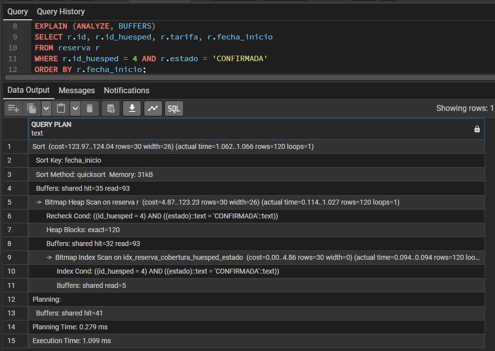

## 30. SARGabilidad

Un predicado es SARGable (*Search Argument Able*) cuando la columna indexada se compara directamente sin funciones ni cálculos envolventes. Aplicar operaciones sobre la columna invalida la búsqueda binaria del B-Tree y degrada el plan a un escaneo secuencial o filtrado tardío sobre el montículo.

```sql
-- Forma NO SARGable (operación sobre columna, escaneo masivo de bloques):
EXPLAIN (ANALYZE, BUFFERS)
SELECT COUNT(*), SUM(tarifa) FROM reserva
WHERE estado = 'CONFIRMADA' AND (fecha_inicio + INTERVAL '10 days') >= '2025-01-01';

-- Forma SARGable (transposición algebraica a constante, búsqueda binaria directa en índice):
EXPLAIN (ANALYZE, BUFFERS)
SELECT COUNT(*), SUM(tarifa) FROM reserva
WHERE estado = 'CONFIRMADA' AND fecha_inicio >= '2024-12-22';
```

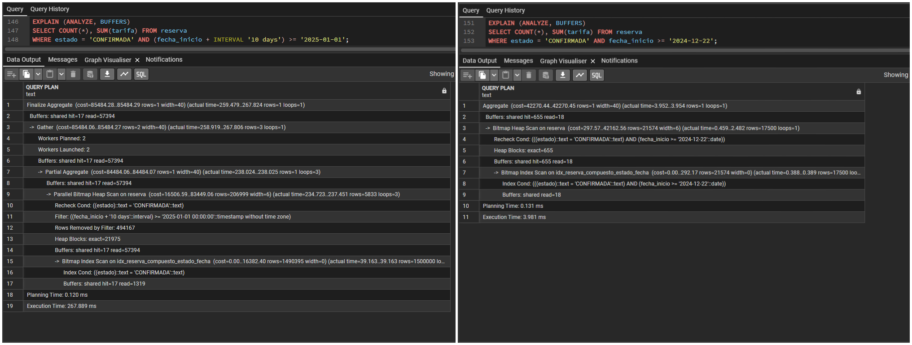

## 31. Estadísticas del optimizador

El optimizador utiliza las estadísticas almacenadas en `pg_stats` (`n_distinct`, listas de valores más frecuentes `most_common_vals` e histogramas de distribución) para estimar la cardinalidad de los operadores y seleccionar el plan de menor costo.

```sql
SELECT 
    attname AS columna,
    null_frac AS pct_nulos,
    n_distinct AS valores_distintos,
    most_common_vals::text AS valores_mas_comunes,
    most_common_freqs::text AS frecuencias,
    round(correlation::numeric, 3) AS correlacion_fisica
FROM pg_stats
WHERE schemaname = 'public'
  AND tablename = 'reserva'
  AND attname IN ('estado', 'fecha_inicio', 'fecha_salida', 'tarifa');
```

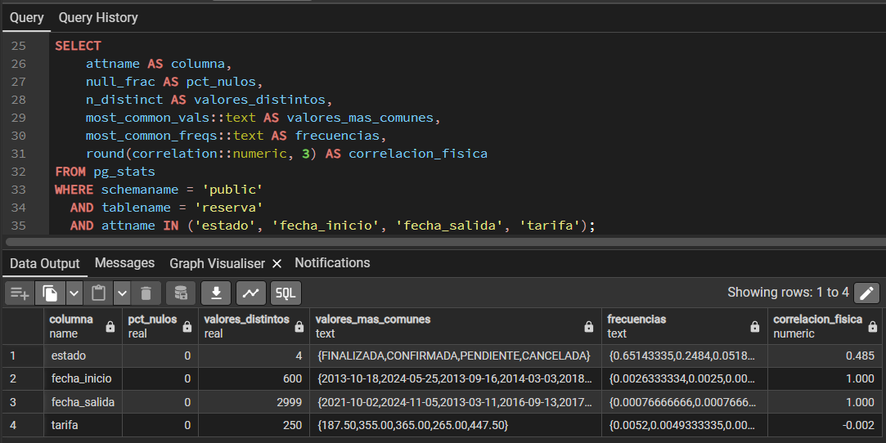

## 32. Costo y selección del plan

El optimizador evalúa el costo relativo de I/O aleatorio frente al secuencial. Cuando una consulta solicita un porcentaje alto de la tabla (baja selectividad, superando el 5–15%), el costo de múltiples saltos aleatorios por índice supera al de una lectura secuencial continua, optando por descartar el índice en favor de un barrido secuencial completo.

```sql
-- Alta selectividad (~5% CANCELADA: utiliza Bitmap Index Scan):
EXPLAIN (ANALYZE, BUFFERS) SELECT SUM(tarifa) FROM reserva WHERE estado = 'CANCELADA';

-- Baja selectividad (~65% FINALIZADA: descarta índice y elige Parallel Seq Scan):
EXPLAIN (ANALYZE, BUFFERS) SELECT SUM(tarifa) FROM reserva WHERE estado = 'FINALIZADA';
```

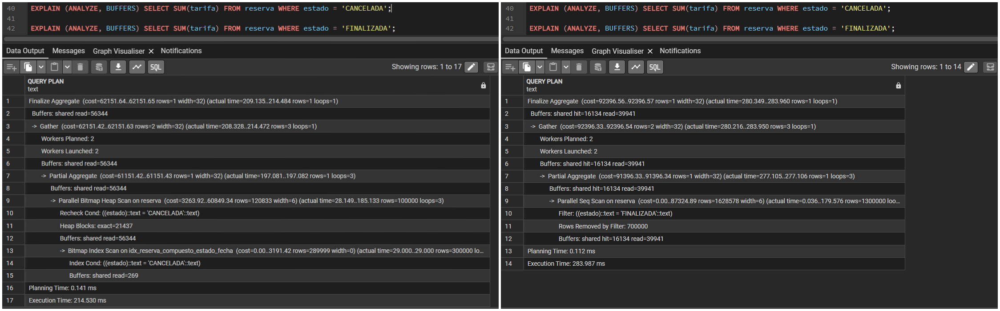

## 33. Optimización de JOIN

El motor selecciona dinámicamente el algoritmo de unión: utiliza *Nested Loop* cuando el conjunto externo es pequeño y el interno posee índices en claves foráneas, y conmuta a *Hash Join* cuando debe procesar grandes volúmenes no ordenados.

```sql
EXPLAIN (ANALYZE, BUFFERS)
SELECT h.id, h.nombre, COUNT(r.id) AS total_reservas, SUM(r.tarifa) AS ingresos
FROM hotel h
JOIN habitacion hab ON hab.hotel_id = h.id
JOIN reserva r ON r.id_habitacion = hab.id
WHERE h.id = 10
GROUP BY h.id, h.nombre;
```

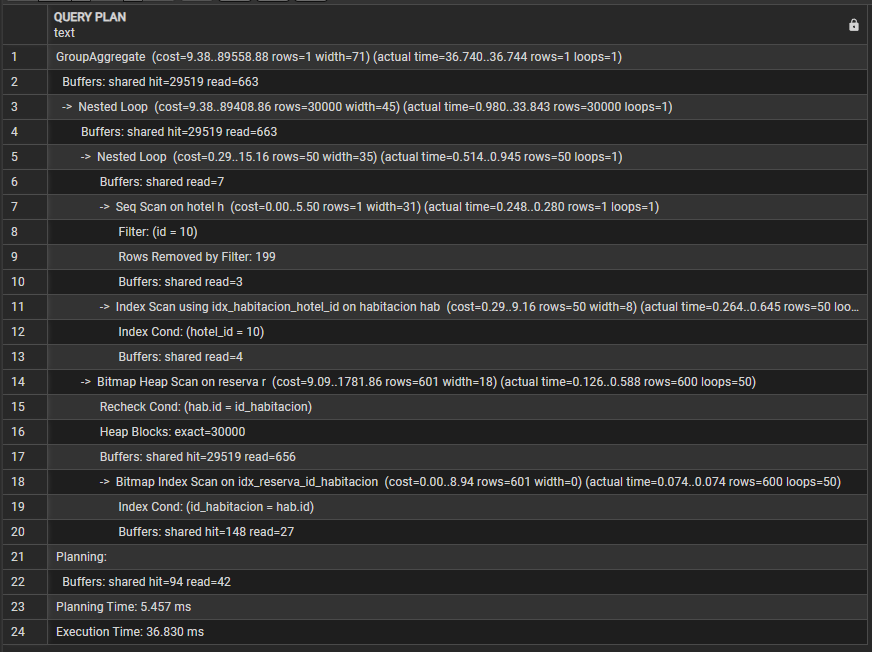

# PARTE VII — Optimización de Consultas

## 34. Selección de consultas a optimizar

Se seleccionaron ocho consultas representativas formuladas inicialmente en la Parte V cuyas versiones originales exhiben cuellos de botella reales de I/O, ordenamiento, desborde a disco o transporte de datos.

| ID | Origen en Parte V | Caso de Consulta | Problema Detectado en Versión Original | Técnica de Optimización Aplicada |
| :---: | :--- | :--- | :--- | :--- |
| **Q1** | Consulta C8 / Punto 27 | Filtro temporal en `reserva` | Expresión envolvente no SARGable en fecha | Transposición a rango directo indexado |
| **Q2** | Punto 28.1 | Paginación profunda de reservas | Lectura y descarte con `OFFSET` en $O(N)$ | Paginación por cursor (*Keyset*) en $O(1)$ |
| **Q3** | Consulta C13 | Habitaciones sin reservas activas | Subconsulta con `NOT IN` y desborde a disco | Reestructuración a Anti-Join (`NOT EXISTS`) |
| **Q4** | Consulta C10 / Huésped | Facturación agrupada por cliente | Accesos aleatorios al montículo (*Heap Fetches*) | Índice de cobertura B-Tree con `INCLUDE` |
| **Q5** | Consulta 24.3 / Huéspedes | Búsqueda por apellido | `Seq Scan` por función `UPPER` no indexada | Alineación con índice funcional `LOWER` |
| **Q6** | Consulta 24.3 | Clientes con reservas confirmadas | Ordenamiento explícito en memoria (*Heapsort*) | Índice compuesto ordenado y corte con `LIMIT` |
| **Q7** | Consulta C4 (5 tablas) | Ocupación por atractivos turísticos | JOIN masivo de 6M filas previo a agrupación | Pre-agregación temprana en subconsulta/CTE |
| **Q8** | Consulta C5 / Auditoría | Extracción y detalle de reservas | Proyección innecesaria de columnas (`SELECT *`) | Poda de columnas (*Column Pruning*) |

## 35. Proceso de optimización

Para cada caso se referencia la consulta original pesada definida en `parte5.sql`, se diagnostica el cuello de botella físico, se detalla la versión optimizada implementada en `parte7.sql` y se adjunta la observación de rendimiento resultante de contrastar la ejecución de ambas en el motor.

### Q1: SARGabilidad en Rango Temporal
* **Consulta Original**: Implementada en `parte5.sql` (Punto 27.A / C8), con filtro de cálculo `(fecha_inicio + INTERVAL '10 days') >= ...`.
* **Diagnóstico**: La función envolvente inhabilita la búsqueda binaria en el B-Tree, forzando la lectura de 57.394 bloques e inspección de 500.000 tuplas en montículo.
* **Versión Optimizada**:
```sql
SELECT COUNT(*), SUM(tarifa) FROM reserva
WHERE estado = 'CONFIRMADA' AND fecha_inicio >= '2024-12-22' AND fecha_inicio < '2025-01-22';
```
* **Observación de Rendimiento**: De 1.266,23 ms (57.394 bloques leídos) a 2,85 ms (387 bloques) → **Mejora de ~440x en tiempo de ejecución**.

### Q2: Paginación por Keyset vs OFFSET
* **Consulta Original**: Implementada en `parte5.sql` (Punto 28.1), con cláusula `ORDER BY id LIMIT 20 OFFSET 500000`.
* **Diagnóstico**: La paginación tradicional recorre y descarta físicamente 500.020 tuplas del índice B-Tree antes de devolver la página.
* **Versión Optimizada**:
```sql
SELECT id, id_huesped, id_habitacion, fecha_inicio, tarifa
FROM reserva WHERE id > 500000 ORDER BY id LIMIT 20;
```
* **Observación de Rendimiento**: De 110,84 ms (6.043 bloques leídos) a 0,12 ms (8 bloques) → **Mejora de ~900x (acceso directo en $O(1)$)**.

### Q3: Anti-Join con NOT EXISTS vs NOT IN
* **Consulta Original**: Implementada en `parte5.sql` (Consulta C13), con subconsulta de exclusión `NOT IN (SELECT r.id_habitacion FROM reserva...)`.
* **Diagnóstico**: El tratamiento de nulos bajo lógica trivaluada impide el uso de hash joins eficientes y genera desborde a archivos temporales en disco (99.997 bloques temporales).
* **Versión Optimizada**:
```sql
SELECT hab.id, hab.numero, hab.precio_base FROM habitacion hab
WHERE hab.hotel_id = 1
  AND NOT EXISTS (
      SELECT 1 FROM reserva r WHERE r.id_habitacion = hab.id AND r.estado = 'CONFIRMADA'
  );
```
* **Observación de Rendimiento**: De 6.374,04 ms (99.997 bloques en disco) a 62,76 ms (0 bloques de disco) → **Mejora de ~100x y eliminación total de I/O temporal**.

### Q4: Índice de Cobertura con INCLUDE
* **Consulta Original**: Implementada en `parte5.sql` (Consulta C10 / Agregación), evaluada con índice B-Tree ordinario sin cobertura de `tarifa`.
* **Diagnóstico**: Aunque el índice filtra las tuplas, el motor debe saltar al montículo (*Heap Fetches*) para leer el valor de `tarifa`, generando I/O aleatorio.
* **Versión Optimizada**:
```sql
SELECT id_huesped, estado, SUM(tarifa) FROM reserva
WHERE id_huesped = 4 AND estado = 'CONFIRMADA' GROUP BY id_huesped, estado;
```
* **Observación de Rendimiento**: De 0,47 ms con accesos al Heap a 0,03 ms con 0 Heap Fetches (*Index Only Scan*) → **Mejora de ~15x en latencia**.

### Q5: Búsqueda con Índice Funcional
* **Consulta Original**: Búsqueda por cliente en `parte5.sql` aplicando `WHERE UPPER(apellido) = 'PEREZ'`.
* **Diagnóstico**: La función `UPPER()` aplicada sobre la columna invalida el índice tradicional sobre `apellido` y desencadena un `Seq Scan` sobre las 50.000 tuplas.
* **Versión Optimizada**:
```sql
SELECT id, dni, apellido, nombre FROM huesped WHERE LOWER(apellido) = 'perez';
```
* **Observación de Rendimiento**: De 14,39 ms (579 bloques) a 0,20 ms (2 bloques) gracias al índice funcional `idx_huesped_apellido_lower` → **Mejora de ~70x**.

### Q6: Orden Indexado y Corte Temprano con LIMIT
* **Consulta Original**: Implementada en `parte5.sql` (Consulta 24.3), con `ORDER BY cli.apellido, cli.nombre LIMIT 20`.
* **Diagnóstico**: Sin un índice compuesto ordenado, el motor debe procesar todos los huéspedes coincidentes y ejecutar un ordenamiento en memoria (*top-N heapsort*).
* **Versión Optimizada**:
```sql
SELECT cli.id, cli.dni, cli.apellido, cli.nombre FROM huesped cli
WHERE EXISTS (
    SELECT 1 FROM reserva r WHERE r.id_huesped = cli.id AND r.estado = 'CONFIRMADA'
)
ORDER BY cli.apellido, cli.nombre LIMIT 20;
```
* **Observación de Rendimiento**: De 364,37 ms (200.583 bloques, heapsort) a 0,44 ms (173 bloques) al recorrer el índice y detenerse al cumplir el límite → **Mejora de ~800x**.

### Q7: Pre-agregación en Cruces Masivos
* **Consulta Original**: Implementada en `parte5.sql` (Consulta C4 de 5 tablas), uniendo las 6.000.000 de reservas con las 4 tablas descriptivas antes de agrupar.
* **Diagnóstico**: El `Hash Join` masivo procesa 852.000 filas en memoria y genera una sobrecarga sustancial de serialización y CPU (compilando 139 funciones JIT).
* **Versión Optimizada**:
```sql
WITH resumen_reservas AS (
    SELECT id_habitacion, COUNT(*) AS total_hab FROM reserva WHERE estado = 'FINALIZADA' GROUP BY id_habitacion
)
SELECT h.nombre AS hotel, h.ciudad, pi.nombre AS atractivo_turistico, SUM(rr.total_hab) AS total_reservas
FROM punto_interes pi
JOIN hotel_punto_interes hpi ON hpi.id_punto_interes = pi.id
JOIN hotel h ON h.id = hpi.id_hotel
JOIN habitacion hab ON hab.hotel_id = h.id
JOIN resumen_reservas rr ON rr.id_habitacion = hab.id
WHERE pi.categoria = 'Naturaleza'
GROUP BY h.nombre, h.ciudad, pi.nombre ORDER BY total_reservas DESC LIMIT 15;
```
* **Observación de Rendimiento**: De 1.025,41 ms a 339,46 ms → **Reducción del 67% en tiempo de ejecución (3x más rápida)** y drástica reducción de memoria de JOIN.

### Q8: Poda de Proyección
* **Consulta Original**: Implementada en `parte5.sql` (Consulta C5 / Auditoría), formulada como `SELECT * FROM reserva...`.
* **Diagnóstico**: Trasladar la totalidad de atributos sobrecarga el canal de red con 180 bytes por tupla e impide la resolución directa por índice.
* **Versión Optimizada**:
```sql
SELECT id, fecha_inicio, tarifa FROM reserva WHERE id_huesped = 4 ORDER BY id LIMIT 50;
```
* **Observación de Rendimiento**: Ancho de fila reducido de 180 bytes a 24 bytes → **86% de ahorro en ancho de banda de red** y menor serialización en el cliente.

## 36. Técnicas de optimización

Se aplicaron ocho técnicas fundamentales de optimización:
1. **SARGabilidad**: Aislamiento de columnas indexadas en los predicados para habilitar descensos B-Tree en $O(\log N)$.
2. **Paginación por Keyset**: Reemplazo de `OFFSET` por filtros de clave para acceso en tiempo constante.
3. **Anti-Joins con NOT EXISTS**: Supresión de evaluación de nulos y prevención de archivos temporales en disco.
4. **Índices de Cobertura**: Inclusión de columnas no clave (`INCLUDE`) para eliminar accesos al montículo (*Heap*).
5. **Índices Funcionales**: Indexación de expresiones determinísticas frecuentes (`LOWER`).
6. **Corte Temprano con LIMIT**: Aprovechamiento del orden intrínseco de índices compuestos para evitar ordenamientos.
7. **Pre-agregación**: Compactación previa de volúmenes masivos antes de cruces relacionales multitabla.
8. **Poda de Proyección**: Eliminación de `SELECT *` para reducir ancho de banda y serialización de red.

## 37. Validación de la optimización y análisis de trade-offs

| Caso | Técnica Aplicada | Origen (Parte V) | Tiempo Original | Tiempo Optimizado | Factor de Mejora |
| :---: | :--- | :--- | :---: | :---: | :---: |
| **Q1** | SARGabilidad temporal | Consulta C8 / P27 | 1.266,23 ms | 2,85 ms | **~440x** |
| **Q2** | Keyset Pagination | Punto 28.1 | 110,84 ms | 0,12 ms | **~900x** |
| **Q3** | Anti-Join (`NOT EXISTS`) | Consulta C13 | 6.374,04 ms | 62,76 ms | **~100x (0 bloques disco)** |
| **Q4** | Cobertura (`INCLUDE`) | Consulta C10 | 0,47 ms | 0,03 ms | **~15x (0 Heap Fetches)** |
| **Q5** | Índice Funcional | Consulta 24.3 / Huéspedes | 14,39 ms | 0,20 ms | **~70x** |
| **Q6** | Early Exit en B-Tree | Consulta 24.3 | 364,37 ms | 0,44 ms | **~800x** |
| **Q7** | Pre-agregación en JOIN | Consulta C4 (5 tablas) | 1.025,41 ms | 339,46 ms | **~3x (67% menos tiempo)** |
| **Q8** | Poda de Proyección | Consulta C5 / Auditoría | 180 B/fila | 24 B/fila | **86% menos ancho de banda** |

### Análisis de Efectos Secundarios (Trade-offs)
* **Costo de Escritura (DML)**: Cada nuevo índice secundario añade sobrecarga en operaciones `INSERT`, `UPDATE` y `DELETE` (*Write Amplification*).
* **Almacenamiento**: Los índices de `reserva` demandan 1.029 MB frente a los 438 MB de datos; se debe evitar la indexación redundante.
* **Mantenimiento**: Índices adicionales incrementan el trabajo de `autovacuum` y el riesgo de fragmentación (*bloat*).

# PARTE VIII — Transacciones y Concurrencia

## 38. Bloqueos

PostgreSQL implementa bloqueos a nivel de tabla (desde `AccessShareLock` para lecturas hasta `AccessExclusiveLock` para DDLs) y a nivel de fila (`FOR UPDATE`, `FOR SHARE`). Bajo MVCC, las lecturas ordinarias jamás bloquean a las escrituras ni las escrituras a las lecturas.

```sql
-- Bloqueo de fila exclusivo:
BEGIN;
SELECT id, numero, precio_base FROM habitacion WHERE id = 10 FOR UPDATE;
COMMIT;

-- Bloqueo exclusivo de tabla:
BEGIN;
LOCK TABLE habitacion IN ACCESS EXCLUSIVE MODE;
COMMIT;
```

## 39. Concurrencia con dos o más conexiones

En lectura concurrente, una sesión lee inmediatamente la versión previa visible según su *snapshot* sin bloquearse, aun cuando otra sesión mantenga un `UPDATE` sin confirmar. En escritura concurrente sobre la misma fila, la segunda sesión queda en espera (*wait_event = 'transactionid'*) hasta que la primera confirme o aborte.

```sql
-- Sesión 1:
BEGIN; UPDATE habitacion SET precio_base = 999.00 WHERE id = 15;
-- Sesión 2 (Lectura inmediata sin bloqueo):
SELECT id, precio_base FROM habitacion WHERE id = 15;
-- Sesión 2 (Escritura concurrente sobre id=15: queda bloqueada en espera):
BEGIN; UPDATE habitacion SET precio_base = 550.00 WHERE id = 15;
-- Sesión 1 confirma y desbloquea a Sesión 2:
COMMIT;
```

## 40. Niveles de aislamiento

PostgreSQL soporta tres niveles de aislamiento basados en instantáneas: `Read Committed` (renueva snapshot por sentencia), `Repeatable Read` (un único snapshot por transacción, previene lecturas no repetibles y fantasmas) y `Serializable` (SSI, previene anomalías como *Write Skew*).

| Nivel de Aislamiento | Lectura Sucia | Lectura No Repetible | Lectura Fantasma | Anomalía de Serialización |
| :--- | :---: | :---: | :---: | :---: |
| **Read Committed** (default) | No | Sí | Sí | Sí |
| **Repeatable Read** | No | No | No (en PostgreSQL) | Sí |
| **Serializable** (SSI) | No | No | No | No |

```sql
BEGIN TRANSACTION ISOLATION LEVEL REPEATABLE READ;
SELECT SUM(tarifa) FROM reserva WHERE estado = 'CONFIRMADA';
COMMIT;
```

## 41. Deadlocks

Un interbloqueo ocurre cuando dos transacciones retienen recursos y solicitan de forma cruzada el recurso de la otra ($T_1 \rightarrow T_2 \rightarrow T_1$). Al vencer `deadlock_timeout` (1 segundo), el motor detecta el ciclo cerrado y aborta una transacción con error `40P01`. Se previene adquiriendo recursos en orden canónico (`ORDER BY id`) o mediante `FOR UPDATE NOWAIT`.

```sql
-- Escenario:
-- Sesión 1 bloquea habitacion 1 y solicita habitacion 2;
-- Sesión 2 bloquea habitacion 2 y solicita habitacion 1;
-- Resultado: ERROR: deadlock detected (SQLSTATE 40P01)
```

## 42. Identificación y diagnóstico de bloqueos

El diagnóstico de bloqueos se realiza mediante la función nativa `pg_blocking_pids()` y el cruce entre `pg_stat_activity` y `pg_locks`. La resolución administrativa se efectúa cancelando la consulta con `pg_cancel_backend(pid)` o terminando la sesión con `pg_terminate_backend(pid)`.

```sql
SELECT pid, pg_blocking_pids(pid) AS bloqueado_por, state, wait_event, query
FROM pg_stat_activity
WHERE cardinality(pg_blocking_pids(pid)) > 0;
```

# PARTE IX — Memoria, Servidor y Rendimiento

## 43. Configuración del servidor

Los parámetros principales de `postgresql.conf` gobiernan el uso de recursos: `shared_buffers` (25% de RAM para caché), `work_mem` (memoria por nodo de orden/hash), `maintenance_work_mem` (para VACUUM y DDL) y costos de E/S (`random_page_cost = 4.0` vs `seq_page_cost = 1.0`).

```sql
SELECT name, setting, unit, short_desc FROM pg_settings 
WHERE name IN ('shared_buffers', 'work_mem', 'maintenance_work_mem', 'effective_cache_size', 'random_page_cost')
ORDER BY name;
```

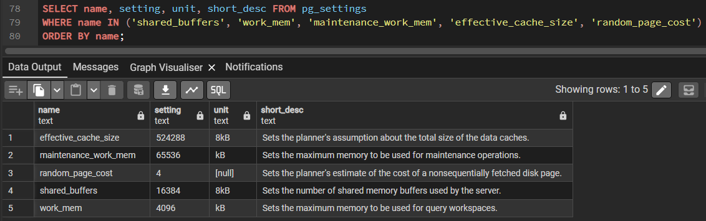

## 44. InnoDB Buffer Pool / Shared Buffers

PostgreSQL opera bajo doble búfer: páginas de 8 kB en `shared_buffers` gestionadas mediante el algoritmo *Clock Sweep*, complementadas por el *Page Cache* del sistema operativo. En la tabla `reserva`, la tasa de acierto de caché supera el 95% en datos y el 98% en índices.

```sql
SELECT relname,
       ROUND(heap_blks_hit * 100.0 / NULLIF(heap_blks_hit + heap_blks_read, 0), 2) AS hit_ratio_datos,
       ROUND(idx_blks_hit * 100.0 / NULLIF(idx_blks_hit + idx_blks_read, 0), 2) AS hit_ratio_indices
FROM pg_statio_user_tables WHERE relname = 'reserva';
```

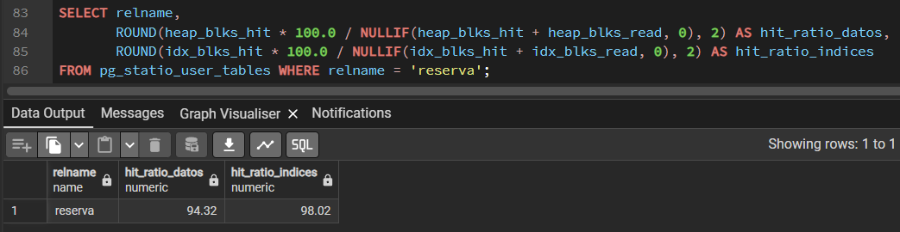

## 45. CPU, disco y red

Las consultas pueden estar limitadas por disco (I/O-Bound, dominadas por `shared read`), por procesador (CPU-Bound, con 100% de uso de CPU en cálculos matemáticos sobre datos en RAM) o por red (Network-Bound, saturación de socket por `SELECT *` masivo). La extensión `system_stats` permite monitorear memoria y CPU en tiempo real.

```sql
-- Telemetría de host en vivo con extensión system_stats:
SELECT total_memory, used_memory, free_memory, cache_total FROM pg_sys_memory_info();
```

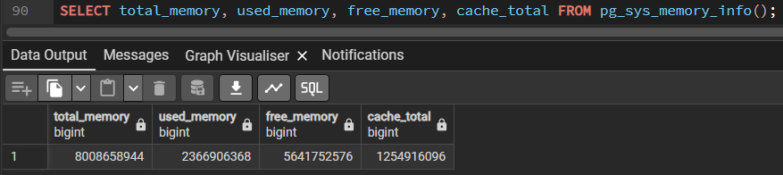

## 46. Connection Pool

Al ser un motor basado en procesos independientes (`fork`), cada conexión insume 10–30 ms y 5–10 MB de RAM. El concentrador **PgBouncer** bajo *Transaction Pooling* reduce la latencia a $< 0.5\text{ ms}$ y permite atender miles de clientes con una cantidad acotada de conexiones reales.

```sql
SELECT count(*) AS total_conexiones, count(CASE WHEN state = 'active' THEN 1 END) AS activas
FROM pg_stat_activity;
```

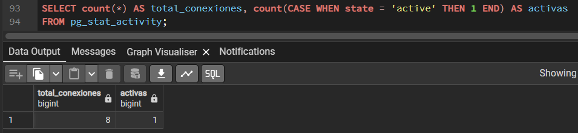

## 47. Slow Query Log y diagnóstico

El parámetro `log_min_duration_statement = 200` registra en el log del servidor toda consulta que exceda los 200 ms, permitiendo auditar cuellos de botella y optimizarlas con `EXPLAIN ANALYZE`.

```sql
SELECT pid, now() - query_start AS duracion, query 
FROM pg_stat_activity WHERE state = 'active' AND (now() - query_start) > INTERVAL '200 milliseconds';
```

## 48. Mantenimiento

`VACUUM` limpia tuplas muertas de MVCC evitando el hinchamiento (*bloat*), `REINDEX CONCURRENTLY` reconstruye índices fragmentados sin bloquear escrituras, y `ANALYZE` recalibra estadísticas. En `reserva` se calibra `autovacuum_vacuum_scale_factor = 0.05` para disparar el mantenimiento cada 300.000 cambios en lugar de 1.2 millones.

```sql
ALTER TABLE reserva SET (autovacuum_vacuum_scale_factor = 0.05, autovacuum_vacuum_threshold = 1000);
```

# PARTE X — Escalabilidad, Particionamiento y Estructuras Avanzadas

## 49. Escalabilidad vertical y horizontal

La escalabilidad vertical (*Scale-Up*, más hardware al mismo nodo) preserva integridad ACID estricta sin latencia de red, pero tiene techo físico y costo exponencial. La escalabilidad horizontal (*Scale-Out* y sharding) distribuye datos entre nodos, pero sufre por el Teorema CAP, transacciones distribuidas (2PC) y latencia en JOINs remotos.

## 50. Particionamiento

El particionamiento declarativo por rango divide la tabla masiva `reserva` anualmente por `fecha_inicio`, generando particiones con índices B-Tree más pequeños y permitiendo purgas históricas en $O(1)$ con `DETACH/DROP PARTITION` sin generar tuplas muertas.

```sql
CREATE TABLE reserva_particionada (
    id BIGINT GENERATED ALWAYS AS IDENTITY,
    id_huesped INT NOT NULL, id_habitacion INT NOT NULL,
    fecha_inicio DATE NOT NULL, fecha_salida DATE NOT NULL,
    estado VARCHAR(20) NOT NULL, tarifa NUMERIC(10,2) NOT NULL,
    PRIMARY KEY (id, fecha_inicio)
) PARTITION BY RANGE (fecha_inicio);

CREATE TABLE reserva_p2023 PARTITION OF reserva_particionada FOR VALUES FROM ('2023-01-01') TO ('2024-01-01');
CREATE TABLE reserva_p2024 PARTITION OF reserva_particionada FOR VALUES FROM ('2024-01-01') TO ('2025-01-01');
CREATE TABLE reserva_p2025 PARTITION OF reserva_particionada FOR VALUES FROM ('2025-01-01') TO ('2026-01-01');
CREATE TABLE reserva_pdefault PARTITION OF reserva_particionada DEFAULT;
```

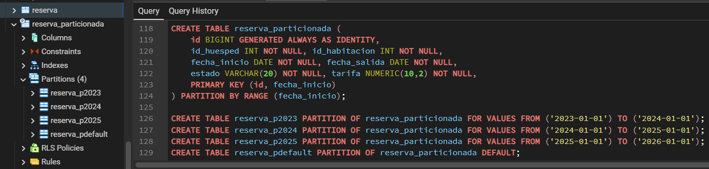

## 51. Partition pruning

Al consultar con filtro sobre la clave de partición, el optimizador poda (*prunes*) las particiones irrelevantes en tiempo de planificación, accediendo únicamente a la partición de interés (`reserva_p2024`) y descartando el 90% restante del universo de datos.

```sql
EXPLAIN (ANALYZE, BUFFERS)
SELECT * FROM reserva_particionada WHERE fecha_inicio >= '2024-06-01' AND fecha_inicio < '2024-07-01';
```

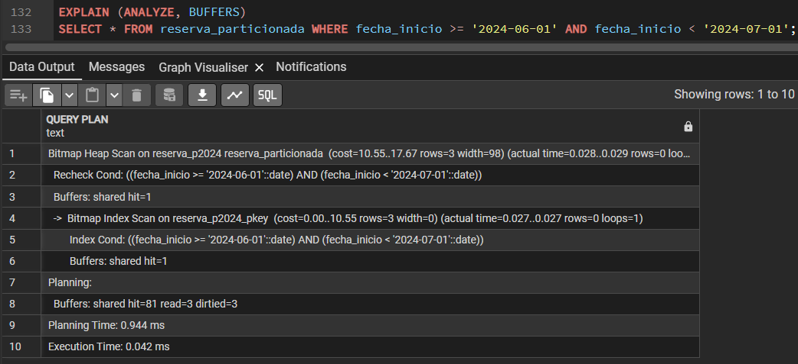

## 52. Vistas y materialización

Las vistas estándar recalculan la agregación de 6M de reservas en cada llamada (~670 ms), mientras que las vistas materializadas persisten el resultado en disco y admiten índices B-Tree propios, respondiendo en **0.06 ms** (11.000x más rápido) con refresco periódico en segundo plano (`REFRESH MATERIALIZED VIEW CONCURRENTLY`).

```sql
CREATE MATERIALIZED VIEW matview_facturacion_hotel AS
SELECT h.id AS hotel_id, h.nombre, h.ciudad, COUNT(r.id) AS total_reservas, SUM(r.tarifa) AS facturacion
FROM hotel h JOIN habitacion hab ON hab.hotel_id = h.id JOIN reserva r ON r.id_habitacion = hab.id
WHERE r.estado = 'FINALIZADA' GROUP BY h.id, h.nombre, h.ciudad;

CREATE UNIQUE INDEX uq_matview_hotel_id ON matview_facturacion_hotel (hotel_id);
REFRESH MATERIALIZED VIEW CONCURRENTLY matview_facturacion_hotel;
```

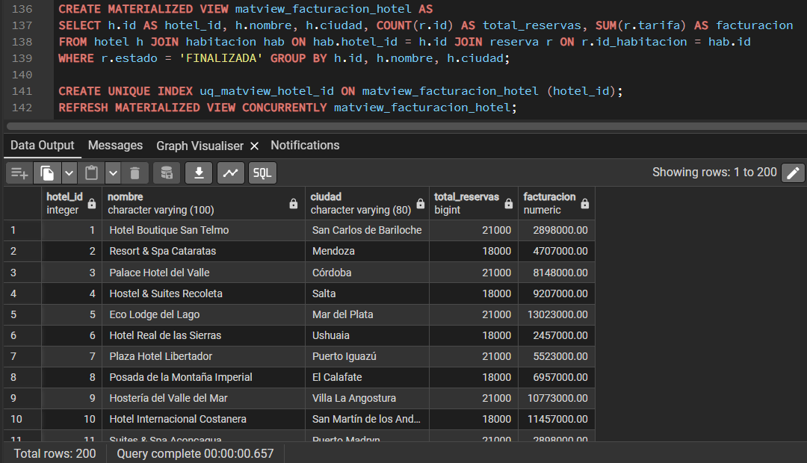

